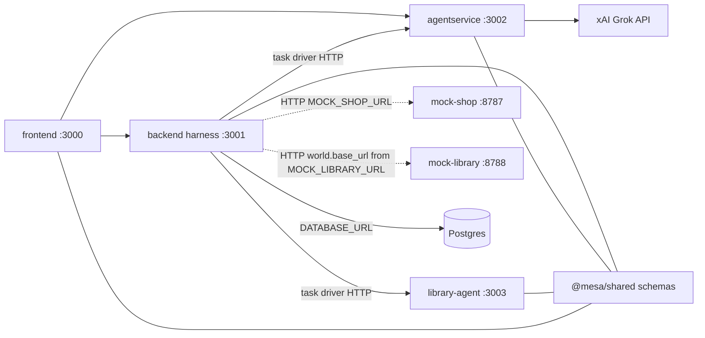

# Runtime architecture

Six HTTP processes, plus Postgres when `DATABASE_URL` is set, plus [`@mesa/shared`](../packages/shared/README.md) as a library. [`services/mock-shop`](../services/mock-shop/README.md) is a stand-alone server on port 8787. [`services/mock-library`](../services/mock-library) is a stand-alone server on port 8788. The backend harness calls each mock by URL. [`apps/library-agent`](../apps/library-agent) is the library desk runtime on port 3003. The reference agent and the library desk return actions with `executed: false`. The harness performs the tool calls. Backend still owns the shop package.



Solid arrows are HTTP between the lab apps, or from the agent service to the xAI Grok API. Dotted arrows are HTTP from the harness to a stand-alone mock. The reference agent and the library desk do not call those mocks. The line to Postgres exists only when `DATABASE_URL` is set. The lines to `@mesa/shared` are the JSON Schema contracts those apps import.

## Ports and URLs

| Process | Path | Port | How callers reach it |
| --- | --- | --- | --- |
| frontend | `apps/frontend` | 3000 | The page itself |
| backend harness | `apps/backend` | 3001 | `VITE_BACKEND_URL` from the UI. `BACKEND_URL` from the agent service |
| agentservice | `apps/agentservice` | 3002 | `VITE_AGENTSERVICE_URL` from the UI. The harness drives `reference-shop` at `instance.base_url` (baseline) or `test_instance.base_url` (injected and after_fix) |
| library-agent | `apps/library-agent` | 3003 | `LIBRARY_AGENT_URL`. Seeded onto `external-library` `instance.base_url` and `test_instance.base_url`. The harness calls `POST {origin}/v1/tasks/run` |
| mock-shop | `services/mock-shop` | 8787 | `MOCK_SHOP_URL` from the harness. The harness sends that value as `mock_base_url` on a shop run |
| mock-library | `services/mock-library` | 8788 | `MOCK_LIBRARY_URL`, stored on `external-library` `world.base_url`. A library run calls that origin |

`pnpm dev` binds `127.0.0.1`. The six web containers bind `0.0.0.0`. For `pnpm dev`, the harness default is `MOCK_SHOP_URL=http://127.0.0.1:8787` and `MOCK_LIBRARY_URL=http://127.0.0.1:8788`. Compose sets `http://mesa-mock-shop:8787` and `http://mesa-mock-library:8788`. The Render Blueprint sets the public shop and library URLs. The agent service does not read a shop base URL. The harness sends `mock_base_url` from `MOCK_SHOP_URL` on a shop run. There is no `SHOP_BASE_URL` env var in this repo. The library desk does not read `MOCK_LIBRARY_URL`. The harness calls the URL stored on the agent.

`instance.base_url` is the agent runtime. It is the address the harness uses to start a task (`POST {origin}/v1/tasks/run`). It is not the shop and it is not the library mock. The seeded shop and library origins are in [seed-endpoints.md](seed-endpoints.md). [`render.yaml`](../render.yaml) names the same six web services: `mesa-frontend`, `mesa-backend`, `mesa-agentservice`, `mesa-mock-shop`, `mesa-library-agent`, and `mesa-mock-library`.

The harness client is `apps/backend/src/mock/`. On a shop run it calls tool routes, `GET /internal/state`, and `POST /internal/reset` on `MOCK_SHOP_URL`. On a library run it uses the same client against `world.base_url`, including `POST /internal/seed`, `GET /internal/state`, and `POST /internal/reset`.

## Write boundaries

[ADR-001](../adr/001-mock-verifier-grok.md) gives each field one writer.

| Field | Writer |
| --- | --- |
| `outcome.verifier` | Backend verifier only. It reads mock state (`GET /internal/state`) and the task's `success_test.checks`. It does not call Grok and it does not read `tasks[].evalset`. `outcome.success` copies `verifier.passed`. The task, including `setup` and check `params`, is data on the agent. See [agent-tasks.md](agent-tasks.md). |
| `fault.labels` | Injector or attacker only. They also write `fault.injected` and `fault.attacker`. |
| `diagnosis` | Grok, through the agent service only. It must not write `outcome.verifier` or `fault.labels`. |
| `tasks[].evalset` | User data on the Agent document, stored by `POST /agents` and `PUT /agents/:agent_id`. Optional. Material a later Grok judgment may read for that task's Run or Trace. It is not a Trace field and it is not a writer of `outcome.verifier`. |
| `Agent.otel` and `POST /agents/:agentId/otel/import` | User-registered source, plus a span batch mapped onto a Trace. The importer copies a supplied `outcome` and writes the empty production `fault`. It does not invent `fault.labels` or `outcome.verifier`, and it does not dial the endpoint. See [otel.md](otel.md). |

`diagnosis` stays null until that service fills it. A proposed fix counts only after a later run, once the agent owner has changed the agent on their own deploy, and the verifier passes.

The explicit backend operation `POST /traces/:traceId/diagnose` loads a stored
trace, posts it to `AGENTSERVICE_URL/diagnose`, validates that the response changes
only `diagnosis`, and conditionally saves that field. A concurrent trace update
causes 409 instead of overwriting it. Existing diagnoses are returned without a
new provider call. The per-trace in-process gate is independent of the mock/world
lock: no shop operation or run is executed by this endpoint. PostgreSQL uses an
atomic jsonb comparison to prevent stale saves across processes, but separate
processes can still incur duplicate provider calls. See the backend README for
the HTTP contract and timeout. This documents runtime wiring, not a change to
ADR-001's recorded status or ADR-002's ownership decisions.

`after_fix` is a new run after the agent owner has changed the agent on their own deploy. The harness calls that deploy (`test_instance.base_url` for injected and `after_fix`). It does not edit the owner's agent in place, and it does not patch the lab world as a stand-in for that change.

On that new request the harness still copies `Run.fix_kinds` onto `AgentRunRequest` (issue #40). `controlled_retry` is applied inside `executeAttempt` for the attempt (issue #41). The reference agent can also shape the action list for that request from `fix_kinds` (`apps/agentservice/src/fixes/`, still `executed: false`). The library desk reads `permission_guard` the same way on its own `POST /v1/tasks/run`. Those flags are request behavior for the new run. They do not rewrite the stored agent. They do not inject faults and they do not write `outcome.verifier` or `fault.*`. See the agent service README for the shop policies, and for the replay that scores T1–T5 with the backend verifier.

Agent, Run, and Trace records live in the backend process. With `DATABASE_URL` set they are rows in one Postgres database and survive a restart. Without it they stay in memory: the process reseeds both demo agents, `reference-shop` and `external-library`, on boot, and runs and traces start empty. The shop catalog and the library catalog stay in memory. Restarting a mock, or `POST /internal/reset` on that mock, restores its seed. Store choice, SQL, the APIs, env vars, and the local runbook are in [persistence.md](persistence.md). The verifier is still the only writer of `outcome.verifier`. Grok still writes only `diagnosis`. The library seed and the docs in [seed-endpoints.md](seed-endpoints.md) and [agent-tasks.md](agent-tasks.md) are what is on main. Issue #109 is still open.

## One writer for the mock world

`prepareWorld` calls `POST /internal/reset` on the mock for that run before each task. On the shop, that reset clears the catalog, carts, orders, and observations for every session. A library task resets the library mock, then seeds its loans. A different `session_id` leaves that reset shared.

This backend process has one gate, [`apps/backend/src/harness/world-gate.ts`](../apps/backend/src/harness/world-gate.ts). `POST /runs` acquires it before the first reset and holds it until that request has taken every snapshot, run the verifier, and saved every result in the batch. `POST /attacker/jury-case` acquires the same gate for the baseline and the attack. When the jury case calls the runner, that call re-enters the gate. A different request is rejected at the gate. The harness does not queue it.

The busy response is HTTP 409:

```json
{
  "error": "world_busy",
  "message": "The mock world is busy with another run on this process. Retry after that run finishes. This is not a verifier failure."
}
```

A verifier failure is HTTP 200. The saved trace has `outcome.verifier.passed` set to false, and the checks say why. The gate leaves the verifier, `outcome`, `fault`, and the check list alone. `POST /agents` also answers HTTP 409 when an id already exists; that body uses `error: "conflict"`. `POST /traces/:traceId/diagnose` does not take this gate. Its 409 bodies are `diagnosis_busy` and `trace_changed`.

`GET /agents`, `GET /runs`, `GET /traces`, and `GET /attacker/jury-case` leave the gate alone. Those reads still answer while a run holds it. The gate releases in a `finally` block on return, on a thrown error, on a harness timeout, and on a failed save. Stored runs and traces stay. The gate does not flush Postgres and does not delete earlier experiments.

The gate lives in one process. A second backend process can still reset the same shop. A script that calls the shop on its own can too, and so can `POST /internal/reset` on the shop. The action A demo uses one harness process and one mock shop. The gate is the whole of the single-writer rule. The shop process is unchanged, and there is no Redis lock and no distributed queue.

## Structured jury

`POST /attacker/jury-case` is the jury launch. There is no second jury route. The body carries the juror note, `task_id` (default T5), and the session grant in `permissions`. Text in the note is appended to the prompt. It is not copied onto `X-Permissions`. The attacked trace sets `fault.attacker` (`used` and `payload_id`) and a Security label. `outcome.verifier` is the verdict. `diagnosis` on this response stays null. `baseline_comparison.source` is `live`, `last`, `frozen`, or `none`. `links.attacked_trace` is `GET /traces/:id`.

The frontend owns the form and Ispeziona traccia. The page route is `/traces/:traceId` (issue #12, still open). This process does not serve that page. A replay is a new run: it sends `parent_run_id` and `fix_kinds: ["permission_guard"]` on the request and stores phase `after_fix`. It does not rewrite the agent record. A 409 from this POST is `world_busy`, the same code as a busy `POST /runs`. `diagnosis_busy` and `trace_changed` remain on `POST /traces/:traceId/diagnose` and do not take this gate. The field split is [Frontend contract](demo-jury.md#frontend-contract-issue-55). `GET /attacker/jury-case` repeats it on `frontend` and does not start a run. The jury form itself is still issue #55.

## Render

The demo Blueprint ([`render.yaml`](../render.yaml)) is six free web services in project `mesa-agent-failure-lab`, environment `demo`: `mesa-frontend`, `mesa-backend`, `mesa-agentservice`, `mesa-mock-shop`, `mesa-library-agent`, and `mesa-mock-library`, plus Postgres `mesa-postgres` for agent, run, and trace records. `DATABASE_URL` on `mesa-backend` comes from that database's internal connection string. Yuri applies the Blueprint in the Render workspace. The steps, the export-before-redeploy order, and the env vars are in [deploy.md](deploy.md) and [persistence.md](persistence.md). Origins per environment are in [seed-endpoints.md](seed-endpoints.md).

`mesa-mock-shop` is still not part of `apps/backend`. `mesa-mock-library` is `services/mock-library`, also separate. The harness `MOCK_SHOP_URL` on Render is the shop's public `https://…onrender.com` URL. `LIBRARY_AGENT_URL` and `MOCK_LIBRARY_URL` on `mesa-backend` are the public library desk and library mock. Boot writes those origins onto `external-library`. Local `pnpm dev` keeps `http://127.0.0.1:8787` and `http://127.0.0.1:8788`.
