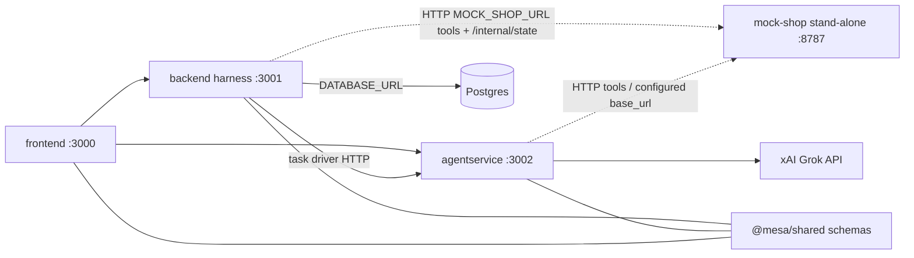

# Runtime architecture

Four HTTP processes, plus [`@mesa/shared`](../packages/shared/README.md) as a library. [`services/mock-shop`](../services/mock-shop/README.md) is a stand-alone server on port 8787. The backend harness and the agent service call it by URL, the same way they would call any other configured target. Backend still owns the package.



Solid arrows are HTTP between the lab apps, or from the agent service to the xAI Grok API. Dotted arrows are HTTP to the stand-alone shop. The line to Postgres exists only when `DATABASE_URL` is set. The lines to `@mesa/shared` are the JSON Schema contracts those apps import.

## Ports and URLs

| Process | Path | Port | How callers reach it |
| --- | --- | --- | --- |
| frontend | `apps/frontend` | 3000 | The page itself |
| backend harness | `apps/backend` | 3001 | `VITE_BACKEND_URL` from the UI. `BACKEND_URL` from the agent service |
| agentservice | `apps/agentservice` | 3002 | `VITE_AGENTSERVICE_URL` from the UI. The harness drives a task at `instance.base_url` (baseline) or `test_instance.base_url` (injected and after_fix) |
| mock-shop | `services/mock-shop` | 8787 | `MOCK_SHOP_URL` from the harness. The harness sends that value as `mock_base_url` |

`pnpm dev` binds `127.0.0.1`. The four containers bind `0.0.0.0`. For `pnpm dev`, the harness default is `MOCK_SHOP_URL=http://127.0.0.1:8787`. Compose sets `http://mesa-mock-shop:8787`. The Render Blueprint sets the public shop URL. The agent service does not read a shop base URL. The harness sends `mock_base_url` from `MOCK_SHOP_URL`. There is no `SHOP_BASE_URL` env var in this repo.

`instance.base_url` is the agent runtime. It is the address the harness uses to start a task (`POST {origin}/v1/tasks/run`). It is not the shop. The seeded shop and library origins are in [seed-endpoints.md](seed-endpoints.md).

The harness client is `apps/backend/src/mock/`. It calls tool routes, `GET /internal/state`, and `POST /internal/reset` on `MOCK_SHOP_URL`. The agent service uses the same HTTP surface for tools.

## Write boundaries

[ADR-001](../adr/001-mock-verifier-grok.md) gives each field one writer.

| Field | Writer |
| --- | --- |
| `outcome.verifier` | Backend verifier only. It reads mock state (`GET /internal/state`) and the task's `success_test.checks`. It does not call Grok. `outcome.success` copies `verifier.passed`. The task, including `setup` and check `params`, is data on the agent. See [agent-tasks.md](agent-tasks.md). |
| `fault.labels` | Injector or attacker only. They also write `fault.injected` and `fault.attacker`. |
| `diagnosis` | Grok, through the agent service only. It must not write `outcome.verifier` or `fault.labels`. |

`diagnosis` stays null until that service fills it. A proposed fix counts only after the harness replays the task and the verifier passes.

The explicit backend operation `POST /traces/:traceId/diagnose` loads a stored
trace, posts it to `AGENTSERVICE_URL/diagnose`, validates that the response changes
only `diagnosis`, and conditionally saves that field. A concurrent trace update
causes 409 instead of overwriting it. Existing diagnoses are returned without a
new provider call. The per-trace in-process gate is independent of the mock/world
lock: no shop operation or run is executed by this endpoint. PostgreSQL uses an
atomic jsonb comparison to prevent stale saves across processes, but separate
processes can still incur duplicate provider calls. See the backend README for
the HTTP contract and timeout. This documents runtime wiring, not a change to
ADR-001's recorded status or ADR-002's ownership decisions.

The fix applicator lives in `apps/agentservice/src/fixes/`. It turns `controlled_retry`, `pre_response_check`, and `permission_guard` into behavior around a shop tool client, and into the action list `planTaskRun` returns with `executed: false`. The harness copies `Run.fix_kinds` onto that request for `after_fix`, and applies `controlled_retry` inside `executeAttempt` without importing this package. The applicator does not inject faults and it does not write `outcome.verifier` or `fault.*`. See the agent service README for that glue, and for the replay that scores T1–T5 with the backend verifier.

Agent, Run, and Trace records live in the backend process. With `DATABASE_URL` set they are rows in one Postgres database and survive a restart. Without it they stay in memory: the process reseeds `reference-shop` on boot, and runs and traces start empty. The shop catalog is still in memory. Restarting the shop, or `POST /internal/reset`, restores the seed catalog. Store choice, SQL, the APIs, env vars, and the local runbook are in [persistence.md](persistence.md). The verifier is still the only writer of `outcome.verifier`. Grok still writes only `diagnosis`.

## One writer for the mock world

`prepareWorld` calls `POST /internal/reset` on the shop before each task. That reset clears the catalog, carts, orders, and observations for every session. A different `session_id` leaves that reset shared.

This backend process has one gate, [`apps/backend/src/harness/world-gate.ts`](../apps/backend/src/harness/world-gate.ts). `POST /runs` acquires it before the first reset and holds it until that request has taken every snapshot, run the verifier, and saved every result in the batch. `POST /attacker/jury-case` acquires the same gate for the baseline and the attack. When the jury case calls the runner, that call re-enters the gate. A different request is rejected at the gate. The harness does not queue it.

The busy response is HTTP 409:

```json
{
  "error": "world_busy",
  "message": "The mock world is busy with another run on this process. Retry after that run finishes. This is not a verifier failure."
}
```

A verifier failure is HTTP 200. The saved trace has `outcome.verifier.passed` set to false, and the checks say why. The gate leaves the verifier, `outcome`, `fault`, and the check list alone. `POST /agents` also answers HTTP 409 when an id already exists; that body uses `error: "conflict"`. `POST /traces/:traceId/diagnose` does not take this gate. Its 409 bodies are `diagnosis_busy` and `trace_changed`.

`GET /agents`, `GET /runs`, `GET /traces`, and `GET /attacker/jury-case` leave the gate alone. Those reads still answer while a run holds it. The gate releases in a `finally` block on return, on a thrown error, on a harness timeout, and on a failed save. Stored runs and traces stay. The gate does not flush Postgres and does not delete earlier experiments.

The gate lives in one process. A second backend process can still reset the same shop. A script that calls the shop on its own can too, and so can `POST /internal/reset` on the shop. The action A demo uses one harness process and one mock shop. The gate is the whole of the single-writer rule. The shop process is unchanged, and there is no Redis lock and no distributed queue.

## Structured jury

`POST /attacker/jury-case` is the jury launch. There is no second jury route. The body carries the juror note, `task_id` (default T5), and the session grant in `permissions`. Text in the note is appended to the prompt. It is not copied onto `X-Permissions`. The attacked trace sets `fault.attacker` (`used` and `payload_id`) and a Security label. `outcome.verifier` is the verdict. `diagnosis` on this response stays null. `baseline_comparison.source` is `live`, `last`, `frozen`, or `none`. `links.attacked_trace` is `GET /traces/:id`.

The frontend owns the form and Ispeziona traccia. The page route is `/traces/:traceId` (issue #12). This process does not serve that page. A replay sends `parent_run_id` and `fix_kinds: ["permission_guard"]` and stores phase `after_fix`. A 409 from this POST is `world_busy`, the same code as a busy `POST /runs`. `diagnosis_busy` and `trace_changed` remain on `POST /traces/:traceId/diagnose` and do not take this gate. The field split is [Frontend contract](demo-jury.md#frontend-contract-issue-55). `GET /attacker/jury-case` repeats it on `frontend` and does not start a run.

## Render

The demo Blueprint ([`render.yaml`](../render.yaml)) is four free web services in project `mesa-agent-failure-lab`, environment `demo`: frontend, backend, agentservice, and mock-shop, plus Postgres `mesa-postgres` for agent, run, and trace records. `DATABASE_URL` on `mesa-backend` comes from that database's internal connection string. Yuri applies the Blueprint in the Render workspace. The steps, the export-before-redeploy order, and the env vars are in [deploy.md](deploy.md) and [persistence.md](persistence.md).

`mesa-mock-shop` is that fourth service. It is still not part of `apps/backend`. The harness `MOCK_SHOP_URL` on Render is the shop's public `https://…onrender.com` URL. Local `pnpm dev` keeps `http://127.0.0.1:8787`.
