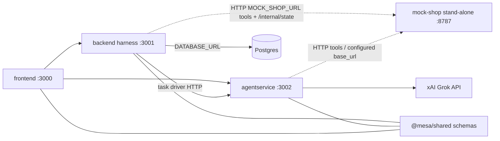

# Runtime architecture

Four HTTP processes, plus [`@mesa/shared`](../packages/shared/README.md) as a library. [`services/mock-shop`](../services/mock-shop/README.md) is a stand-alone server on port 8787. The backend harness and the agent service call it by URL, the same way they would call any other configured target. Backend still owns the package.

Solid arrows are HTTP between the lab apps, or from the agent service to the xAI Grok API. Dotted arrows are HTTP to the stand-alone shop. The line to Postgres exists only when `DATABASE_URL` is set. The lines to `@mesa/shared` are the JSON Schema contracts those apps import.

## Ports and URLs

| Process | Path | Port | How callers reach it |
| --- | --- | --- | --- |
| frontend | `apps/frontend` | 3000 | The page itself |
| backend harness | `apps/backend` | 3001 | `VITE_BACKEND_URL` from the UI. `BACKEND_URL` from the agent service |
| agentservice | `apps/agentservice` | 3002 | `VITE_AGENTSERVICE_URL` from the UI. The harness drives a task at `instance.base_url` (baseline) or `test_instance.base_url` (injected and after_fix) |
| mock-shop | `services/mock-shop` | 8787 | `MOCK_SHOP_URL` from the harness. The harness sends that value as `mock_base_url` |

`pnpm dev` binds `127.0.0.1`. The four containers bind `0.0.0.0`. For `pnpm dev`, the harness default is `MOCK_SHOP_URL=http://127.0.0.1:8787`. Compose sets `http://mesa-mock-shop:8787`. The Render Blueprint sets the public shop URL. The agent service does not read a shop base URL. The harness sends `mock_base_url` from `MOCK_SHOP_URL`. There is no `SHOP_BASE_URL` env var in this repo.

`instance.base_url` is the agent runtime. It is the address the harness uses to start a task. It is not the shop.

The harness client is `apps/backend/src/mock/`. It calls tool routes, `GET /internal/state`, and `POST /internal/reset` on `MOCK_SHOP_URL`. The agent service uses the same HTTP surface for tools.

## Write boundaries

[ADR-001](../adr/001-mock-verifier-grok.md) gives each field one writer.

| Field | Writer |
| --- | --- |
| `outcome.verifier` | Backend verifier only. It reads mock state (`GET /internal/state`) and the task's `success_test.checks`. It does not call Grok. `outcome.success` copies `verifier.passed`. |
| `fault.labels` | Injector or attacker only. They also write `fault.injected` and `fault.attacker`. |
| `diagnosis` | Grok, through the agent service only. It must not write `outcome.verifier` or `fault.labels`. |

`diagnosis` stays null until that service fills it. A proposed fix counts only after the harness replays the task and the verifier passes.

The fix applicator lives in `apps/agentservice/src/fixes/`. It turns `controlled_retry`, `pre_response_check`, and `permission_guard` into behavior around a shop tool client, and into the action list `planTaskRun` returns with `executed: false`. The harness copies `Run.fix_kinds` onto that request for `after_fix`, and applies `controlled_retry` inside `executeAttempt` without importing this package. The applicator does not inject faults and it does not write `outcome.verifier` or `fault.*`. See the agent service README for that glue, and for the replay that scores T1–T5 with the backend verifier.

Agent, Run, and Trace records live in the backend process. With `DATABASE_URL` set they are rows in one Postgres database and survive a restart. Without it they stay in memory: the process reseeds `reference-shop` on boot, and runs and traces start empty. The shop catalog is still in memory. Restarting the shop, or `POST /internal/reset`, restores the seed catalog. Store choice, SQL, the APIs, env vars, and the local runbook are in [persistence.md](persistence.md). The verifier is still the only writer of `outcome.verifier`. Grok still writes only `diagnosis`.

## Render

The demo Blueprint ([`render.yaml`](../render.yaml)) is four free web services in project `mesa-agent-failure-lab`, environment `demo`: frontend, backend, agentservice, and mock-shop, plus a Postgres instance `mesa-postgres` for agent, run, and trace records. Apply steps and env vars are in [deploy.md](deploy.md). Review that database block before the next Blueprint sync. `render.yaml` is not changed by the run/trace store. Provisioning stays with Yuri.

`mesa-mock-shop` is that fourth service. It is still not part of `apps/backend`. The harness `MOCK_SHOP_URL` on Render is the shop's public `https://…onrender.com` URL. Local `pnpm dev` keeps `http://127.0.0.1:8787`.
