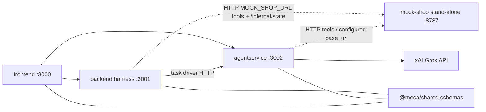

# Runtime architecture

Four HTTP processes, plus [`@mesa/shared`](../packages/shared/README.md) as a library. [`services/mock-shop`](../services/mock-shop/README.md) is a stand-alone server on port 8787. The backend harness and the agent service call it by URL, the same way they would call any other configured target. Backend still owns the package.

Solid arrows are HTTP between the lab apps, or from the agent service to the xAI Grok API. Dotted arrows are HTTP to the stand-alone shop. The lines to `@mesa/shared` are the JSON Schema contracts those apps import.

## Ports and URLs

| Process | Path | Port | How callers reach it |
| --- | --- | --- | --- |
| frontend | `apps/frontend` | 3000 | The page itself |
| backend harness | `apps/backend` | 3001 | `VITE_BACKEND_URL` from the UI. `BACKEND_URL` from the agent service |
| agentservice | `apps/agentservice` | 3002 | `VITE_AGENTSERVICE_URL` from the UI. The harness drives a task at `instance.base_url` (baseline) or `test_instance.base_url` (injected and after_fix) |
| mock-shop | `services/mock-shop` | 8787 | `MOCK_SHOP_URL` from the harness. A configured tool base URL from the agent service |

`pnpm dev` binds `127.0.0.1`. The three app containers bind `0.0.0.0`. Defaults: harness `MOCK_SHOP_URL=http://127.0.0.1:8787`. The reference agent's shop URL is the same host and port (`SHOP_BASE_URL` on [#21](https://github.com/mesagroup/MESA-AgentFailureLab/pull/21)).

`instance.base_url` is the agent runtime. It is the address the harness uses to start a task. It is not the shop.

The harness client is `apps/backend/src/mock/`. It calls tool routes, `GET /internal/state`, and `POST /internal/reset` on `MOCK_SHOP_URL`. The agent service uses the same HTTP surface for tools.

## Write boundaries

[ADR-001](../adr/001-mock-verifier-grok.md) gives each field one writer.

| Field | Writer |
| --- | --- |
| `outcome.verifier` | Backend verifier only. It reads mock state (`GET /internal/state`) and the task's `success_test.checks`. It does not call Grok. `outcome.success` copies `verifier.passed`. |
| `fault.labels` | Injector or attacker only. They also write `fault.injected` and `fault.attacker`. |
| `diagnosis` | Grok, through the agent service only. It must not write `outcome.verifier` or `fault.labels`. |

`diagnosis` stays null until that service fills it. A proposed fix counts only after the harness replays the task and the verifier passes.

The fix applicator lives in `apps/agentservice/src/fixes/`. It turns `controlled_retry`, `pre_response_check`, and `permission_guard` into behavior around a shop tool client. It does not inject faults and it does not write `outcome.verifier` or `fault.*`. See the agent service README for the glue open PR #21 can call, and for the replay that scores T1–T5 with the backend verifier.

Runs, traces, and the shop catalog are in memory. The MVP has no database. Restarting the shop, or `POST /internal/reset`, restores the seed catalog.

## Render

The demo Blueprint ([`render.yaml`](../render.yaml)) is three free web services in project `mesa-agent-failure-lab`, environment `demo`: frontend, backend, and agentservice. Apply steps and env vars are in [deploy.md](deploy.md).

The shop is not on that Blueprint. A hosted shop is tracked with the reference shop agent in [#21](https://github.com/mesagroup/MESA-AgentFailureLab/pull/21). `MOCK_SHOP_URL` is unset on Render. A run that needs the shop points that variable at a shop you started (local default `http://127.0.0.1:8787`).
